# TUẦN 5 - LINUX KERNEL

## 1. Mục tiêu

Trong tuần 5, thực hiện tìm hiểu và thực hành quy trình cơ bản với Linux Kernel:

- Tìm hiểu AOSP và Android Common Kernel.
- Checkout mã nguồn Android Common Kernel.
- Tìm hiểu cấu trúc cây mã nguồn Linux Kernel.
- Tìm hiểu Kernel Configuration.
- Build Linux Kernel cho kiến trúc `x86_64`.
- Kiểm tra kết quả build.
- Tìm hiểu `defconfig`, `.config` và `nconfig`.
- Trích xuất cấu hình thực tế từ kernel đã build.

### Quy trình tổng quát

```text
Android Kernel Manifest
        |
        v
     repo init
        |
        v
     repo sync
        |
        v
Android Common Kernel Source
        |
        v
Kernel Configuration
        |
        v
   Kleaf / Bazel
        |
        v
  Compile + Link
        |
        v
      vmlinux
        |
        v
      bzImage
        |
        v
   Kernel Image
```

---

## 2. Kiến thức cơ bản

### 2.1. Linux Kernel là gì?

Linux Kernel là phần lõi của hệ điều hành Linux.

Kernel đảm nhiệm các chức năng chính:

- Quản lý CPU và lập lịch tiến trình.
- Quản lý bộ nhớ.
- Quản lý filesystem.
- Quản lý network.
- Quản lý device driver.
- Quản lý interrupt.
- Cung cấp giao diện system call cho chương trình user space.

Mô hình giao tiếp cơ bản:

```text
Application
    |
    v
System Call
    |
    v
Linux Kernel
    |
    v
Device Driver
    |
    v
Hardware
```

### 2.2. AOSP là gì?

AOSP là viết tắt của **Android Open Source Project**.

AOSP là dự án mã nguồn mở của nền tảng Android. Trong bài thực hành này không tải toàn bộ Android mà sử dụng **Android Common Kernel**.

Android Common Kernel là Linux Kernel được Google duy trì làm nền tảng chung cho Android.

### 2.3. Repository là gì?

Repository là một kho mã nguồn được Git quản lý.

Một repository thường chứa source code, commit, branch, tag và lịch sử thay đổi.

Ví dụ:

```text
kernel/common
external/zlib
external/kmod
```

### 2.4. Workspace là gì?

Workspace là thư mục làm việc chung chứa nhiều repository.

Trong bài thực hành:

```text
~/aosp-kernel-lab
```

là workspace chính.

Cấu trúc có thể hình dung:

```text
aosp-kernel-lab/
├── common/
├── common-modules/
├── external/
├── prebuilts/
├── tools/
└── .repo/
```

### 2.5. Repo Tool là gì?

`repo` là công cụ dùng để quản lý nhiều Git repository cùng lúc.

```text
Manifest
   |
   v
Repo Tool
   |
   v
Quản lý nhiều Git repository
```

### 2.6. Android Kernel Manifest là gì?

Manifest là file mô tả các repository cần thiết cho workspace.

Manifest cho Repo Tool biết:

- Repository nào cần tải.
- URL repository.
- Branch hoặc revision.
- Đường dẫn lưu repository.

Có thể hiểu:

```text
Manifest = danh sách các repository cần tải
```

---

## 3. Bài 1 - Checkout Android Common Kernel

### 3.1. Tạo workspace

```bash
mkdir -p ~/aosp-kernel-lab
cd ~/aosp-kernel-lab
```


Workspace:

```text
/home/do/aosp-kernel-lab
```
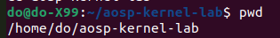

### 3.2. Khởi tạo Repo Workspace

```bash
repo init \
-u https://android.googlesource.com/kernel/manifest \
-b common-android-mainline
```
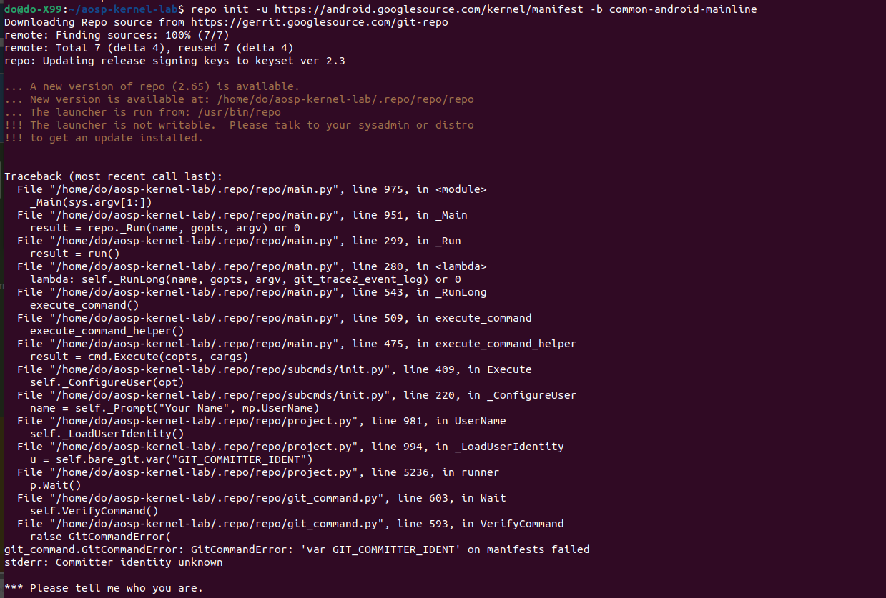
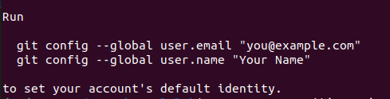
| Thành phần | Ý nghĩa |
|---|---|
| `repo` | Gọi Repo Tool |
| `init` | Khởi tạo workspace |
| `-u` | Chỉ định URL repository chứa manifest |
| `-b` | Chọn branch |
| `common-android-mainline` | Branch manifest được sử dụng |

Sau khi chạy `repo init`, Repo tạo thư mục `.repo/`.

`repo init` chưa tải toàn bộ source. Nó chủ yếu lấy Manifest và chuẩn bị workspace.

### 3.3. Đồng bộ mã nguồn

Ban đầu sử dụng:

```bash
repo sync -c -j$(nproc) -q
```
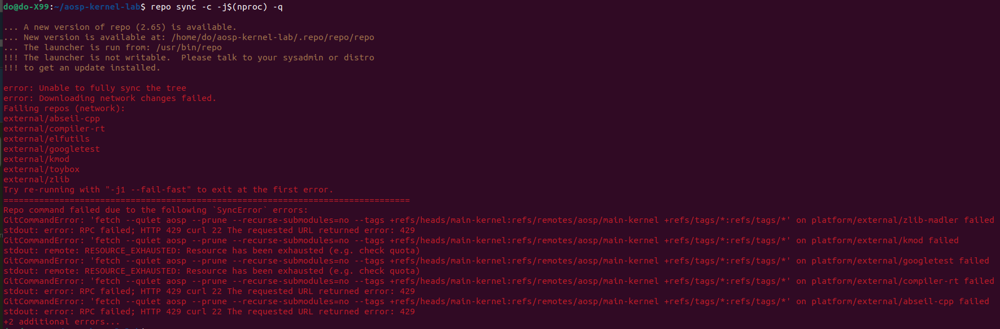
Quá trình gặp lỗi:

```text
HTTP 429
RESOURCE_EXHAUSTED
```
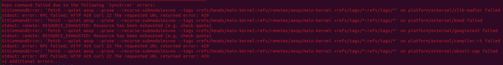
Sau đó giảm số job xuống:

```bash
repo sync -c -j4 --fail-fast
```
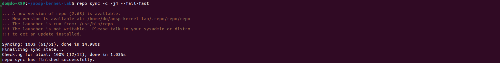
| Tùy chọn | Ý nghĩa |
|---|---|
| `repo sync` | Đồng bộ các repository |
| `-c` | Chỉ sync branch hiện tại |
| `-j4` | Tối đa 4 job chạy song song |
| `--fail-fast` | Dừng ngay khi gặp lỗi đầu tiên |

Kết quả:

```text
Syncing: 100% (61/61), done in 14.980s
Finalizing sync state...
Checking for bloat: 100% (12/12), done in 1.035s
repo sync has finished successfully.
```

Kết luận: mã nguồn đã được đồng bộ thành công.

---

## 4. Khảo sát Linux Kernel Source Tree

```bash
cd ~/aosp-kernel-lab/common
ls
```
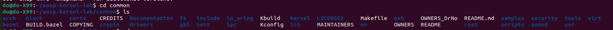
| Thư mục | Chức năng |
|---|---|
| `arch/` | Mã nguồn phụ thuộc kiến trúc CPU |
| `drivers/` | Device Driver |
| `fs/` | Filesystem |
| `include/` | Header của kernel |
| `init/` | Quá trình khởi tạo kernel |
| `kernel/` | Các thành phần lõi của kernel |
| `mm/` | Memory Management |
| `net/` | Networking |

```text
Linux Kernel Source
├── arch/       -> CPU architecture
├── drivers/    -> Device Drivers
├── fs/         -> Filesystem
├── include/    -> Kernel headers
├── init/       -> Kernel initialization
├── kernel/     -> Kernel core
├── mm/         -> Memory Management
└── net/        -> Networking
```

---

## 5. Kernel Configuration

Kernel Configuration quyết định thành phần nào được build vào kernel.

```text
CONFIG_XXX=y
```

Tính năng được build trực tiếp vào kernel.

```text
CONFIG_XXX=m
```

Tính năng được build thành kernel module `.ko`.

```text
# CONFIG_XXX is not set
```

Tính năng bị tắt.

---

## 6. Defconfig và .config

`defconfig` là cấu hình nền ban đầu.

```text
defconfig
    |
    v
Kernel Build System
    |
    v
.config
    |
    v
Build Kernel
```

Kiểm tra:

```bash
ls common/arch/x86/configs/
```

Kết quả có `gki_defconfig`, `x86_64_defconfig`, `i386_defconfig` và các file cấu hình khác.

---

## 7. Kiểm tra một số cấu hình quan trọng

### 7.1. CONFIG_MODULES

```bash
grep "CONFIG_MODULES" common/arch/x86/configs/gki_defconfig
```
```text
CONFIG_MODULES=y
```

Kernel hỗ trợ Loadable Kernel Module.

### 7.2. CONFIG_SMP

```bash
grep "CONFIG_SMP" common/arch/x86/configs/gki_defconfig
```

```text
CONFIG_SMP=y
```

`SMP` là **Symmetric Multiprocessing**, cho phép kernel hỗ trợ nhiều CPU/core.

### 7.3. CONFIG_IKCONFIG

```bash
grep "CONFIG_IKCONFIG" common/arch/x86/configs/gki_defconfig
```

```text
CONFIG_IKCONFIG=y
CONFIG_IKCONFIG_PROC=y
```
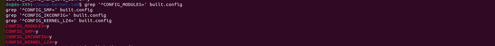
---

## 8. Bài 2 - Build Linux Kernel x86_64

Android Common Kernel sử dụng hệ thống build **Kleaf/Bazel**.

```text
Kernel Source
     +
Kernel Configuration
     |
     v
Kleaf / Bazel
     |
     v
Compiler
     |
     v
Object Files
     |
     v
Linker
     |
     v
Kernel Binary
```

### 8.1. Build Virtual Device x86_64

```bash
cd ~/aosp-kernel-lab

tools/bazel run \
 //common-modules/virtual-device:virtual_device_x86_64_dist
```
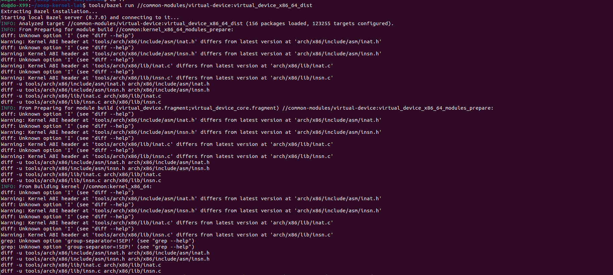
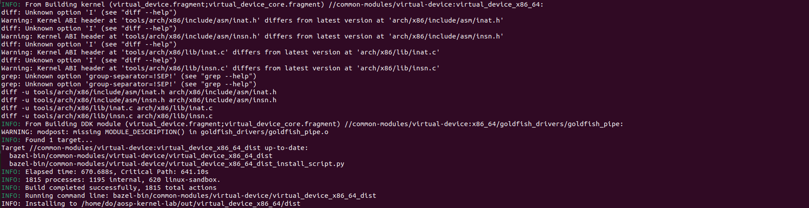
Kết quả thực tế:

```text
INFO: Elapsed time: 670.688s, Critical Path: 641.10s
INFO: 1815 processes: 1195 internal, 620 linux-sandbox.
INFO: Build completed successfully, 1815 total actions
INFO: Installing to /home/do/aosp-kernel-lab/out/virtual_device_x86_64/dist
```

Kernel đã được build thành công.


---

## 9. Kiểm tra Kernel Image

### 9.1. bzImage

```bash
ls -lh out/virtual_device_x86_64/dist/bzImage
```

Kết quả:

```text
-rw-r--r-- 1 do do 27M ... out/virtual_device_x86_64/dist/bzImage
```

`bzImage` có kích thước khoảng **27 MB**.

### 9.2. vmlinux

```bash
ls -lh out/virtual_device_x86_64/dist/vmlinux
```

Kết quả:

```text
-rw-r--r-- 1 do do 245M ... out/virtual_device_x86_64/dist/vmlinux
```

`vmlinux` có kích thước khoảng **245 MB**.

| File | Ý nghĩa |
|---|---|
| `vmlinux` | Kernel binary dạng ELF, phục vụ debug và phân tích |
| `bzImage` | Kernel Image đã được đóng gói để boot trên x86/x86_64 |

```text
Kernel Source
     +
.config
     |
     v
Compiler
     |
     v
Object Files
     |
     v
Linker
     |
     v
vmlinux
     |
     v
Compression / Packaging
     |
     v
bzImage
```

---

## 10. Bài 3 - Kiểm tra Kernel Configuration bằng nconfig

```bash
tools/bazel run //common:kernel_x86_64_config -- nconfig
```

Giao diện hiển thị:

```text
.config - Linux/x86_64 7.1.0 Kernel Configuration
```
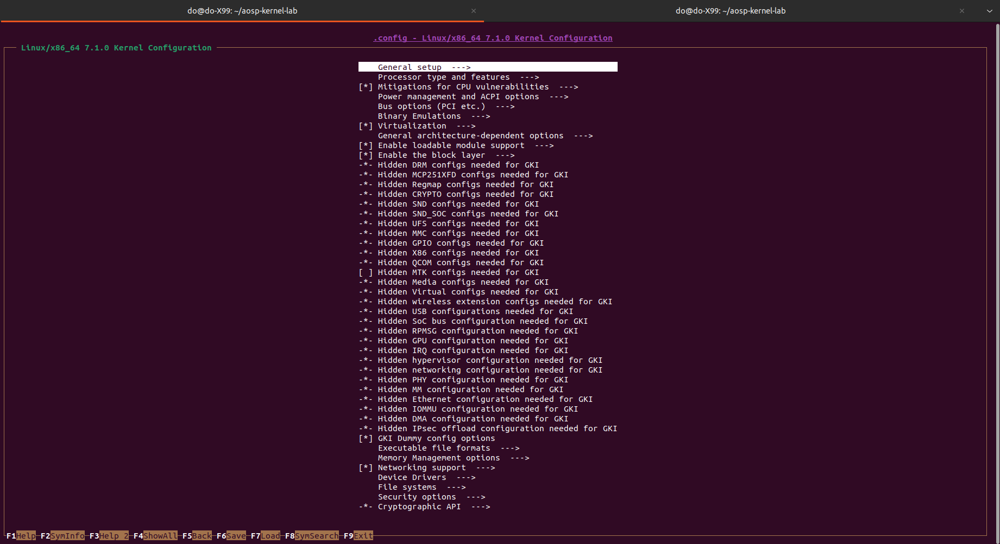
Một số nhóm cấu hình quan trọng:

- General setup
- Processor type and features
- Power management and ACPI options
- Bus options
- Virtualization
- Enable loadable module support
- Networking support
- Device Drivers
- File systems
- Security options
- Cryptographic API

| Ký hiệu | Ý nghĩa |
|---|---|
| `[*]` | Tính năng được bật |
| `<M>` | Build thành kernel module |
| `[ ]` | Tính năng bị tắt |

---

## 11. Trích xuất .config thực tế từ Kernel

Ban đầu thử:

```bash
common/scripts/extract-ikconfig \
out/virtual_device_x86_64/dist/bzImage \
> built.config
```
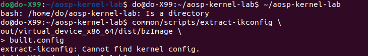
Kết quả:

```text
extract-ikconfig: Cannot find kernel config.
```

Sau đó trích xuất từ `vmlinux`.

Kiểm tra LZ4:

```bash
lz4 --version
```
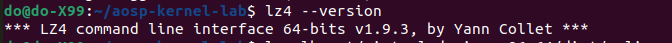
Kết quả:

```text
LZ4 command line interface 64-bits v1.9.3
```

Trích xuất:

```bash
common/scripts/extract-ikconfig \
out/virtual_device_x86_64/dist/vmlinux \
> built.config
```

Kiểm tra:

```bash
head -n 20 built.config
```
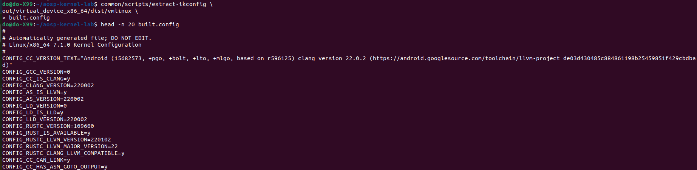
Kết quả đầu file:

```text
#
# Automatically generated file; DO NOT EDIT.
# Linux/x86_64 7.1.0 Kernel Configuration
#
CONFIG_CC_VERSION_TEXT="Android (...) clang version 22.0.2 ..."
CONFIG_GCC_VERSION=0
CONFIG_CC_IS_CLANG=y
CONFIG_CLANG_VERSION=220002
CONFIG_AS_IS_LLVM=y
...
```

Như vậy đã trích xuất được cấu hình thực tế của kernel đã build.

---

## 12. Kiểm tra built.config

```bash
grep '^CONFIG_MODULES=' built.config
grep '^CONFIG_SMP=' built.config
grep '^CONFIG_IKCONFIG=' built.config
grep '^CONFIG_KERNEL_LZ4=' built.config
```

Kết quả:
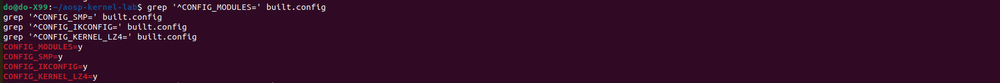
```text
CONFIG_MODULES=y
CONFIG_SMP=y
CONFIG_IKCONFIG=y
CONFIG_KERNEL_LZ4=y
```

| Config | Ý nghĩa |
|---|---|
| `CONFIG_MODULES=y` | Kernel hỗ trợ loadable module |
| `CONFIG_SMP=y` | Kernel hỗ trợ nhiều CPU/core |
| `CONFIG_IKCONFIG=y` | Kernel có nhúng thông tin cấu hình |
| `CONFIG_KERNEL_LZ4=y` | Kernel sử dụng LZ4 làm phương thức nén |

---

## 13. Liên hệ với quá trình boot Linux

```text
Power ON
   |
   v
Boot ROM
   |
   v
Bootloader
   |
   v
Load Kernel Image + DTB vào RAM
   |
   v
Kernel Start
   |
   v
Initialize CPU / Memory / Driver
   |
   v
Mount RootFS
   |
   v
Start init / systemd
   |
   v
Services
   |
   v
User Applications
```

File `bzImage` được sử dụng tại bước Bootloader nạp Kernel Image vào RAM.

---

## 14. Lỗi gặp phải và cách xử lý

### 14.1. HTTP 429 khi repo sync

Lỗi:

```text
HTTP 429
RESOURCE_EXHAUSTED
```

Cách xử lý:

```bash
repo sync -c -j4 --fail-fast
```

Kết quả:

```text
repo sync has finished successfully.
```

### 14.2. Repo launcher không writable

Thông báo:

```text
A new version of repo is available.
The launcher is not writable.
```

Đây là cảnh báo về phiên bản Repo Tool và quyền ghi vào `/usr/bin/repo`, không làm quá trình sync thất bại.

### 14.3. Cannot find kernel config từ bzImage

Lỗi:

```text
extract-ikconfig: Cannot find kernel config.
```

Giải pháp:

```bash
common/scripts/extract-ikconfig \
out/virtual_device_x86_64/dist/vmlinux \
> built.config
```

Kết quả: trích xuất thành công.

---

## 15. Kết quả đạt được

- [x] Tìm hiểu Linux Kernel.
- [x] Tìm hiểu AOSP và Android Common Kernel.
- [x] Tìm hiểu Repository, Workspace và Repo Tool.
- [x] Tìm hiểu Android Kernel Manifest.
- [x] Khởi tạo Repo Workspace.
- [x] Sync thành công 61 repository.
- [x] Khảo sát Linux Kernel Source Tree.
- [x] Tìm hiểu `defconfig` và `.config`.
- [x] Build Kernel x86_64 bằng Kleaf/Bazel.
- [x] Build thành công 1815 actions.
- [x] Tạo `vmlinux` khoảng 245 MB.
- [x] Tạo `bzImage` khoảng 27 MB.
- [x] Mở Kernel Configuration bằng `nconfig`.
- [x] Trích xuất `.config` thực tế từ `vmlinux`.
- [x] Kiểm tra `CONFIG_MODULES`.
- [x] Kiểm tra `CONFIG_SMP`.
- [x] Kiểm tra `CONFIG_IKCONFIG`.
- [x] Kiểm tra `CONFIG_KERNEL_LZ4`.

---

## 16. Kết luận

Trong Tuần 5 đã thực hiện đầy đủ quy trình từ checkout mã nguồn Android Common Kernel đến build Linux Kernel cho kiến trúc `x86_64`.

Mã nguồn được quản lý bằng Repo Tool dựa trên Android Kernel Manifest. Sau khi thực hiện `repo init` và `repo sync`, workspace Android Common Kernel được tạo thành công.

Kernel được build bằng hệ thống Kleaf/Bazel. Quá trình build tạo ra:

```text
vmlinux : khoảng 245 MB
bzImage : khoảng 27 MB
```

Kernel Configuration được kiểm tra thông qua `gki_defconfig`, `nconfig` và file `built.config` được trích xuất trực tiếp từ `vmlinux`.

Quy trình tổng thể:

```text
Manifest
   |
   v
repo init
   |
   v
repo sync
   |
   v
Kernel Source
   |
   v
Kernel Configuration
   |
   v
Kleaf / Bazel
   |
   v
Compile + Link
   |
   v
vmlinux
   |
   v
bzImage
   |
   v
Kernel Image
```


